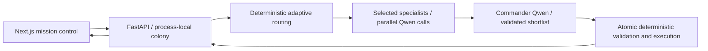

# HIVE — Mars colony mission control

HIVE coordinates resource-constrained colony recovery with Qwen2.5-7B-Instruct,
LangGraph and a deterministic simulator. Built for the NVIDIA × Red Hat Small
Models Hackathon. The model is served through vLLM on NVIDIA Brev L40S; this
repository does not provision or restart that infrastructure.

Three specialists (Energy, Life Support, Engineering) provide real model
proposals. Adaptive routing records why each participates or is skipped. Commander
compares proposals with deterministic feasible-plan forecasts, selects a validated
plan and explains rejections. The simulator revalidates the whole plan atomically
and reports actual resource/module changes. Explanations are public decision
summaries, not hidden chain-of-thought. The Science card is not a connected agent.

## Tech stack and architecture

| Layer | Implementation |
|---|---|
| Mission control | Next.js 15, React 19, TypeScript, Tailwind CSS |
| API and schemas | Python, FastAPI, Pydantic, Uvicorn |
| Agent orchestration | LangGraph, LangChain OpenAI-compatible client |
| Inference | Qwen/Qwen2.5-7B-Instruct, vLLM, NVIDIA Brev L40S |
| Simulation and evaluation | Local deterministic Python simulator, pytest, CSV/JSONL records |



## Quick start

Run commands from `~/projects/hive`. Prerequisites (tested locally): Python 3.12, Node.js 22 with
npm, curl, and access to the existing Qwen vLLM endpoint. This setup installs the
application dependencies; it does not provision a GPU or install/start vLLM.
If the virtual environment and frontend dependencies already exist, skip setup.

```sh
cd ~/projects/hive
python3 -m venv backend/.venv
backend/.venv/bin/python -m pip install -r backend/requirements.txt
cd hive-frontend
npm ci
cd ..
```

### Environment variables and sample .env

Create a local `backend/.env` with the following contents. **The backend does not
automatically load this file**; source it explicitly as shown below. These values
select the judging configuration; the launcher also sets the version flags.

```dotenv
HIVE_LIVE_AGENTS=true
HIVE_GRAPH_VERSION=v2
HIVE_SPECIALIST_ROUTING=true
HIVE_PLANNING_HORIZON=3
HIVE_PHYSICS_VERSION=v1
OPENAI_API_BASE=http://127.0.0.1:8001/v1
HIVE_MODEL=Qwen/Qwen2.5-7B-Instruct
OPENAI_API_KEY=ollama
```

`OPENAI_API_KEY=ollama` is a placeholder for the existing unauthenticated local
vLLM service, not a paid OpenAI key. If your model service requires authentication,
use its actual token privately. No OpenAI, NVIDIA, or Red Hat cloud API key is
required by the application when connecting to this existing local endpoint.
Do not commit real credentials. The launcher accepts `OPENAI_API_BASE` and
`OPENAI_API_KEY` from the environment and fixes the documented model/version flags.

Create or update `hive-frontend/.env.local`:

```dotenv
NEXT_PUBLIC_DEMO_MODE=false
NEXT_PUBLIC_API_BASE_URL=http://localhost:8000
```

Next.js loads `.env.local` automatically. All `NEXT_PUBLIC_*` values are public;
never put API keys there. Preserve any existing local configuration before editing.

### Run the verified judging configuration

Use the existing Python virtual environment and frontend dependencies. First make
sure your existing vLLM endpoint is reachable; no scripted fallback is substituted:

```sh
set -a
source backend/.env
set +a
curl --fail --max-time 5 http://127.0.0.1:8001/v1/models
bash scripts/demo-backend.sh
```

The launcher explicitly enables live inference, graph v2 / selection policy v2.1,
adaptive routing, horizon 3 and **original physics v1**. It starts only FastAPI,
on localhost:8000, with one worker. A failed model preflight stops the launcher.
For an already-running API, inspect `/health`; changing its environment requires
relaunching that application process. Do not restart the GPU or vLLM service.
Health reports configuration, not model availability. Default backend settings
remain scripted/v1; invoke this launcher for judging.

In another terminal:

```sh
cd hive-frontend
NEXT_PUBLIC_DEMO_MODE=false NEXT_PUBLIC_API_BASE_URL=http://localhost:8000 npm run build
npm run start
```

Open http://localhost:3000. If running remotely, forward ports 3000 and 8000 to
your laptop; the API URL is resolved by the browser. Use localhost (the configured
CORS origin). `NEXT_PUBLIC_*` values are embedded at build time. The checked-in
frontend adapter also supports an explicitly labeled scripted demo; it is not
live inference. No cloud credentials belong in browser environment variables.

`GET /health` must report `live_agents:true`, `graph_version:"v2"`,
`selection_policy:"v2.1"`, `specialist_routing:true`, `physics_version:"v1"`,
and `model:"Qwen/Qwen2.5-7B-Instruct"`. The UI displays this identity and last
recorded routing reasons; statuses are polled during inference. Reset, inject a
crisis, then run a decision. Injection and decision each advance one tick;
refreshes do not. Crises persist until explicitly cleared. Human directives use
keyword simulator commands, not a separate model call. This unauthenticated,
in-memory demo is intended for localhost, with no persistence or multi-worker use.

### Reproduce a crisis response

In the browser, click **Reset Simulation**, select **Dust Storm**, click **Trigger
Crisis**, then **Run HIVE Decision**. Inspect recorded routing, real proposals,
any detected conflicts, Commander decisions, and executed resource deltas. A
conflict is not guaranteed; the UI only displays actual backend events.

The same sequence can be exercised from a third terminal. These commands reset
and mutate the running demo colony, so use them only on your demo session:

```sh
curl --fail --max-time 5 http://localhost:8000/health
curl --fail --max-time 5 -X POST http://localhost:8000/simulation/reset
curl --fail --max-time 5 -X POST http://localhost:8000/simulation/crisis \
  -H 'Content-Type: application/json' -d '{"crisis":"dust_storm"}'
curl --fail --max-time 90 -X POST http://localhost:8000/agents/decide
```

If model preflight fails, check endpoint connectivity or your existing tunnel.
Do not silently substitute scripted responses or report this as a successful
live run. For a colony-isolated smoke test, use `scripts/verify-demo.py` below.

## Datasets and synthetic-data provenance

HIVE does not ingest an external dataset or perform project-specific model
training/fine-tuning. Inference uses the existing pretrained Qwen checkpoint;
its original training corpus is upstream model provenance, not data produced or
curated by this project.

All colony inputs are **project-defined synthetic simulation data**, not NASA
telemetry, measured Mars life-support data, or calibrated engineering predictions:

- [simulator.py](backend/simulator.py) defines initial resource levels, module
  health, passive consumption/regeneration and crisis drains. Resources use an
  abstract 0–100 scale; displayed units do not constitute physical calibration.
- [actions.py](backend/actions.py) defines deterministic action costs, benefits,
  repair effects and constraints. These are authored simulation assumptions,
  rather than numerical effects invented by the model.
- [benchmark.py](backend/benchmark.py) defines four fixed synthetic scenarios:
  dust storm, power failure, oxygen leak and scarce-fuel dust storm. Both planners
  start from matched states; the protocol uses seed `20261017` with derived
  per-run seeds. Physical transitions are deterministic; model generation may vary.
- [demo.ts](hive-frontend/lib/demo.ts) provides the separate scripted frontend
  demonstration. Its generated events are not live inference or benchmark evidence.
- [benchmark_results](backend/benchmark_results/) contains generated evaluation
  outputs: individual CSV measurements, JSONL prompts/responses and state traces,
  summaries, manifests and archived sources. These are experiment records from
  synthetic scenarios, not training examples or independently collected real data.

## Recorded evaluation and reproducibility

[Judge comparison card](docs/BENCHMARK_CARD.md) ·
[three-minute script and checklist](docs/DEMO.md) ·
[version details](backend/EFFICIENCY.md) ·
[full paired results](backend/benchmark_results/qwen_v21_physics_v1_20261017/summary.md)

Under original physics, HIVE v2.1 recovered **11/12**, versus a fresh generalist's
**5/12**. Mean score was **46.69 vs 47.19**; HIVE used **118,253 vs 42,569 tokens**.
This is a recovery/cost tradeoff, not universal superiority. One HIVE episode
failed JSON parsing and remains included. No evaluation was rerun for presentation.

Reproduce with the same protocol but a **new, nonexistent** output directory:

```sh
backend/.venv/bin/python backend/benchmark.py \
  --base-url http://127.0.0.1:8001/v1 --model Qwen/Qwen2.5-7B-Instruct \
  --steps 3 --repetitions 3 --seed 20261017 \
  --graph-version v2 --physics-version v1 \
  --output-dir backend/benchmark_results/judging_reproduction_NEW
```

Both paths use the same model, action catalog, initial states, crises, validator,
executor and score. Benchmark simulators are isolated from the frontend colony.
The generalist's prompts/capabilities remain unchanged. HIVE additionally uses
classical plan enumeration and different prompts/call counts: this compares whole
engineered systems, not equal compute or isolated benefits of multi-agent reasoning.
Four scenarios × three repetitions × three decisions is exploratory. Seeds are
best effort; load and prefix caching are uncontrolled. Recovery means final
O₂≥40, power≥30, water≥20, food≥20, fuel≥0, no sampled essential exhaustion and
no terminal failure, not clearing the crisis flag. The resource-only weighted
score differs from recovery. Original physics ignores module health in production;
repairs improve health but not production under this version. Abstract action gains,
free rationing and a short forecast horizon limit physical realism. Experimental
physics v2 is separate and disabled for judging. No significance claim is supported.

Raw CSVs, full traces, manifests and source snapshots remain under
`backend/benchmark_results/`. Audit existing records (regenerates comparison
artifacts, not episodes):

```sh
backend/.venv/bin/python backend/benchmark_results/v2_comparison/audit_and_compare.py
backend/.venv/bin/python -m pytest -q
cd hive-frontend
node --test tests/event-presentation.test.cjs
npm run build
```

For a fresh **real** crisis smoke test without mutating the frontend colony:
`backend/.venv/bin/python scripts/verify-demo.py`. This preflights the exact model,
uses the actual FastAPI handlers and live LangGraph, prints real events/deltas,
and exits unsuccessfully on errors. [Latest preparation checks](docs/VERIFICATION.md)
record the current endpoint-availability limitation; archived live inference is
not presented as a successful new run.

## Known limitations and next steps

- **Exploratory evaluation:** only three repetitions per scenario, unequal model
  calls and extra deterministic plan search for HIVE. Next: expand held-out
  scenarios and repetitions, and measure routing/search ablations and cost budgets.
- **Structured-output failures:** bounded validation can reject malformed JSON;
  a failed episode is retained in the results. Next: evaluate parsing robustness
  on retained failure cases without hiding errors or substituting approvals.
- **Abstract simulation:** original physics ignores production effects of module
  damage, free rationing is simplified, and forecasts assume a short hold horizon.
  Next: validate richer mechanics separately with versioned, paired experiments;
  retain original physics for reproducing the submitted results.
- **Local demo deployment:** state is process-local and unauthenticated, with no
  persistence or multi-worker support. Next: persistence and access control before
  any shared public deployment. Human directives are keyword-based operations.
- **Inference availability:** GPU/endpoint access is external to application setup.
  The latest preparation check encountered a refused connection; a fresh live
  run remains required before judging. Next: restore normal connectivity and run
  the isolated smoke test, then rehearse the documented three-minute demo.

These are future tasks, not features claimed by the current submission.
