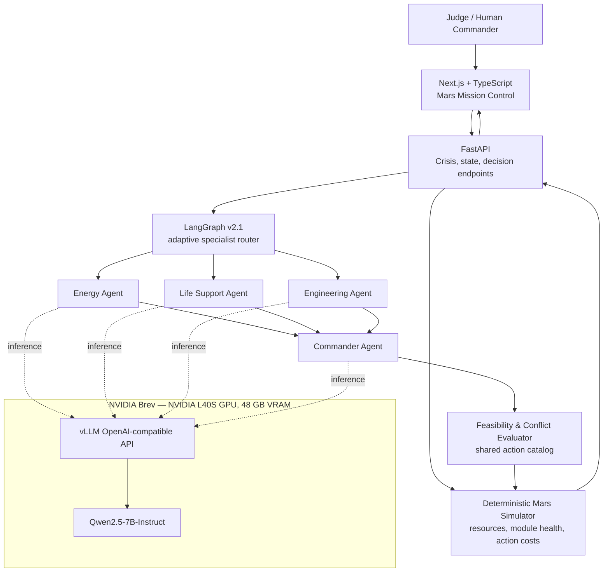
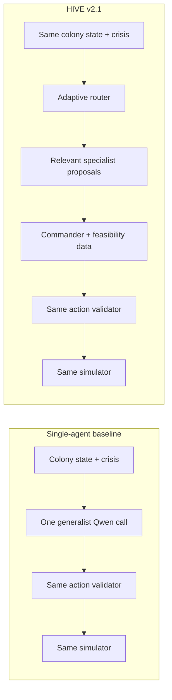

# HIVE — Autonomous Mars Colony
## NVIDIA × Red Hat Small Models Hackathon | Live Demonstration Script

> **Presenter note:** This file is a proposed presentation script based on the reported HIVE v2.1 results. Check agent names, controls, configuration flags, and your submission requirements against the current repository before presenting. Benchmark values are from your exploratory runs, not independently verified here.

## 1. Three-minute judge-facing script

### 0:00–0:25 — The hook: a colony that must decide

**Say:**

“Imagine the first human colony on Mars. A dust storm hits, solar power collapses, oxygen production is threatened, and Earth can't respond quickly enough. You don't just need a chatbot. You need a team of specialized intelligences that can coordinate under resource constraints. That's HIVE.”

**Show:** Open the mission-control dashboard with the Mars colony, live resource meters, survival score, and agent status panel.

### 0:25–0:55 — What we built

**Say:**

“HIVE is a multi-agent emergency-response simulator. LangGraph orchestrates three specialist roles—Energy, Engineering, and Life Support—and a Commander. Specialist activation is adaptive: HIVE can skip agents whose expertise isn't needed. Agents propose actions, but they cannot invent the outcome. A deterministic rule engine checks costs, conflicts, and feasibility, executes approved actions atomically, and measures the real resource changes.”

**Show:** Point out specialist statuses, the Commander, and the negotiation timeline.

### 0:55–1:30 — Why this stack: Brev, L40S, vLLM, Qwen

**Say:**

“We wanted the intelligence to run on an open, relatively small model—not a large closed API. We used NVIDIA Brev because it let us provision a GPU in minutes using the hackathon credits. We chose an NVIDIA L40S with 48 GB of VRAM because it can comfortably serve a 7-billion-parameter model and handle requests from several agents without paying for a much larger GPU. Our selected instance was listed at $1.06 per hour.

“On that GPU, vLLM serves the model through an OpenAI-compatible API. That matters because LangGraph and FastAPI can make standard model requests while inference stays on our own rented hardware. vLLM also supports efficient batching and KV-cache management, important for the multiple calls made by an agent team.

“We chose Qwen2.5-7B-Instruct because its size fits this GPU well, it's instruction-tuned, and it can produce the short, structured action proposals our simulator validates. It was also practical to deploy and test under a very short deadline.”

**Show:** The architecture diagram below. Avoid implying the GPU was free: Brev credits covered the billed compute. Do not claim the model is fine-tuned; it is prompted, served, and orchestrated.

### 1:30–2:15 — Live crisis: show cooperation, not just chat

**Say:**

“Let's trigger a dust storm. Notice that the resource levels change first: that is the simulation, not the model hallucinating numbers. Then HIVE routes the incident to the relevant specialists. They propose actions with costs and tradeoffs. The Commander sees conflicts and selects a feasible plan, while the simulator rejects anything unaffordable or unsafe. The event timeline distinguishes proposals, rejections, executed actions, and observed outcomes.”

**Do:** Reset the colony if needed → trigger a *tested* dust-storm scenario → run the decision cycle. Highlight one actual proposal, one conflict/rejection if present, and one executed action. **Do not promise a conflict will appear in every live run.** If none appears, use a previously measured resource-constrained scenario or recorded trace, clearly labeled.

### 2:15–2:50 — Benchmark: where HIVE helps and what it costs

**Say:**

“We also tested whether multiple agents actually helped. In twelve exploratory episodes under the original simulation physics, our latest HIVE v2.1 recovered **11 of 12**, compared with **5 of 12** for a fresh single-agent baseline using the same Qwen checkpoint. The mean survival score was close, though the single agent was slightly higher: **47.19 versus 46.69**.

“Collaboration isn't free. HIVE used **118,253 tokens** versus **42,569** for the single agent, about **2.78 times as many**. But redesigning HIVE with adaptive specialist routing cut its token consumption by **about 47%** versus the original HIVE and reduced observed episode latency by **about 43%**. This is a small exploratory benchmark, and HIVE's deterministic planning assistance means we cannot attribute the recovery advantage to multiple agents alone.”

**Show:** The benchmark table and bar chart concept below. For judging, focus on recovery and the efficiency improvement *within HIVE* rather than claiming superiority on every metric.

### 2:50–3:00 — Close

**Say:**

“HIVE explores a practical idea: smaller open models can cooperate, but good orchestration also needs selective routing, explicit constraints, and measurable outcomes. The future isn't necessarily more agents. It's knowing which agents to use—and proving that their decisions work.”

---

## 2. System architecture diagram



**Explain:** The diagram separates the *LLM control plane* (agents proposing actions) from the *simulation truth* (validating and applying effects). All active agents can call one hosted model endpoint; separate agents are logical roles, not separate GPU allocations. The actual graph and routing policies should be checked against source before presenting.

## 3. Single-agent vs. HIVE decision pathways



| Dimension | Single-agent baseline | HIVE v2.1 |
|---|---|---|
| Reasoning arrangement | One generalist plans directly | Routed specialists advise; Commander selects |
| Model weights | Qwen2.5-7B-Instruct | Same checkpoint |
| Action execution | Shared deterministic validator/simulator | Same deterministic validator/simulator |
| Conflict handling | One agent must account for constraints | Explicit conflict reports inform Commander |
| Explainability | Generalist recommendation and outcomes | Specialist proposals, activation reasons, conflicts, rejections, and outcomes |
| Computational overhead | Lower in the measured pilot | Higher, even after optimization |
| Strongest observed result | Slightly higher mean survival score and lower token use | Higher recovery rate under original physics |

**Fairness caveat:** The starting states, action catalog, and simulator match, but HIVE v2.1 has additional deterministic planning assistance and a different multi-call structure. The comparison is informative, not a controlled causal test of “number of agents” alone.

## 4. Benchmark: actual exploratory numbers

### Recommended primary comparison: same original simulation physics

| Metric | Fresh single agent | HIVE v2.1 | Interpretation |
|---|---:|---:|---|
| Mean survival score | **47.19** | 46.69 | Single +0.50 points |
| Successful recoveries | 5 / 12 | **11 / 12** | HIVE +6 recovered episodes |
| Recovery rate | 41.7% | **91.7%** | +50 percentage points in this pilot |
| Model calls | **38** | 90 | HIVE ~2.37× as many |
| Tokens used | **42,569** | 118,253 | HIVE ~2.78× as many |
| Mean latency per three-tick episode | 6.79 s | **6.09 s** | HIVE faster in this observed run |

**Recovery definition:** Final oxygen ≥ 40, power ≥ 30, water ≥ 20, food ≥ 20; no essential-resource exhaustion or terminal failure. Sample size: 12 episodes per approach. All failures were included.

### Engineering improvement: original HIVE → HIVE v2.1

| Metric | Original HIVE | HIVE v2.1 (original physics) | Change |
|---|---:|---:|---|
| Mean score | 43.20 | 46.69 | +3.49 |
| Recoveries | 5 / 12 | 11 / 12 | +6 |
| Calls | 146 | 90 | −38.4% |
| Tokens | 224,173 | 118,253 | −47.2% |
| Episode latency | 10.71 s | 6.09 s | −43.1% |

**Important:** Original HIVE and v2.1 were separate exploratory runs. Improvements combine routing, shorter prompts, deterministic planning support, and decision guards. Do not claim to have isolated which component produced each change.

### Experimental alternative: health-dependent physics (NOT final-demo default)

| Metric | Single agent | HIVE v2.1 |
|---|---:|---:|
| Mean score | 46.59 | 46.48 |
| Recoveries | 3 / 12 | 7 / 12 |
| Calls | 41 | 111 |
| Tokens | 49,411 | 157,171 |
| Episode latency | 7.11 s | 6.77 s |

Module-health production effects remain experimental. Final demo recommendation: **HIVE v2.1 with original physics**, unless the configuration and repeatability have changed since these runs.

### Fast visual comparison

```text
Recovery rate (original physics, 12 episodes)
Single  ████████░░░░░░░░░░░░   5/12  = 41.7%
HIVE    ██████████████████░░  11/12 = 91.7%

Tokens (lower is better)
Single  ███████                  42,569
HIVE    ████████████████████    118,253

Mean survival score (higher is better)
Single  47.19
HIVE    46.69
```

This is a visual aid; use the exact numbers in the tables for precision.

## 5. Technical choices: judge Q&A

### Why NVIDIA Brev instead of running the model on your laptop?

Brev provided on-demand access to an NVIDIA GPU without needing a local high-VRAM GPU. It let us keep development in WSL/VS Code while running model inference remotely, and allowed compute spending to be covered by hackathon credits. This also created a clean service boundary: frontend/backend on our development machine, model serving on rented GPU hardware.

### Why the L40S rather than a more expensive GPU?

The selected NVIDIA L40S has **48 GB VRAM**, sufficient for a roughly 7B-parameter BF16 model, its KV cache, and concurrent inference requests in the tested configuration. The event instance listing showed **$1.06/hour**. Using a larger GPU without a proven need would increase cost, not necessarily demo quality. This was a workload-fit decision, **not** a claim that L40S is universally faster or better than H100/A100.

### Why vLLM rather than simply calling a hosted proprietary model?

vLLM offers efficient inference serving for open-weight models, with batching, managed KV caching, and an OpenAI-compatible API. We could control our model deployment, use the same endpoint for multiple agents, and integrate it with LangGraph's model clients. In HIVE, vLLM is **the model server**, not the agent orchestration framework. LangGraph decides which agents run; vLLM runs the model requests.

### Why Qwen2.5-7B-Instruct?

We needed a small, instruction-following open-weight model that was practical to deploy in the remaining hackathon time. Qwen2.5-7B-Instruct fit the L40S and was able to generate short role-specific proposals and Commander plans with the existing structured-output validation. We chose it for *time-to-working-demo, hardware fit, and observed task performance*, not because we proved it was the world's best 7B model. Our model is not fine-tuned for this project.

### Why LangGraph rather than a single prompt?

LangGraph provides explicit routing, shared state, and bounded agent execution. That means we can record which specialists ran, how their proposals reached the Commander, where conflicts emerged, and what the deterministic executor actually did. The baseline comparison shows that this transparency has a compute cost and doesn't always produce the highest score—but in the pilot, v2.1 met recovery thresholds more often.

### Did HIVE actually outperform the single agent?

**On the predefined recovery metric in the original-physics pilot, yes: 11/12 versus 5/12.** Not on every measure: the single agent had a slightly higher average score and used fewer calls/tokens. More importantly, HIVE also received deterministic planning assistance, so the observed improvement cannot be attributed solely to multiple LLM agents. We report the tradeoff rather than hiding it.

### Why did HIVE use 2.78× more tokens, yet have lower measured latency?

HIVE made more model calls, but specialists can execute concurrently and its routing may skip irrelevant ones. The measured end-to-end latency was 6.09 s versus 6.79 s per three-tick episode in this pilot. Timing depends on concurrency, load, prompt sizes, and test conditions; don't generalize a sub-second difference from this small run.

### Can HIVE make unsafe decisions?

Models can make poor recommendations. That is why the simulator does not accept arbitrary model-generated state changes. Proposed actions pass deterministic constraints, cumulative resource checks, and atomic execution. This reduces invalid state changes, but doesn't guarantee optimal strategy or real-world engineering safety. HIVE is a **simulation demonstration**, not a life-critical autonomous controller.

## 6. Live demo operator checklist

- [ ] Git commit pushed; no secrets committed.
- [ ] NVIDIA Brev `hive-gpu` running; vLLM responds to `/v1/models`.
- [ ] WSL port forwarding to the remote inference server is active.
- [ ] FastAPI runs in **live** agent mode, with the documented v2.1 routing flag enabled.
- [ ] Original physics selected; experimental health-dependent physics disabled.
- [ ] Next.js uses `NEXT_PUBLIC_DEMO_MODE=false` and the correct backend URL.
- [ ] Test a reset, dust storm, decision cycle, and result before presenting.
- [ ] Prepare an explicitly labeled recording of a previous real inference run as backup.
- [ ] Have the benchmark summary/CSV ready if judges ask about methodology.
- [ ] Verify submission is complete before the deadline.

**Do not guess the names of the v2.1 feature flags:** read `backend/EFFICIENCY.md` for the exact configuration and document it here once verified.

## 7. One-sentence elevator pitch

“HIVE is a Mars emergency-response simulator where selectively activated small-model agents negotiate resource-constrained decisions, while a deterministic engine checks their actions—and our pilot shows where that teamwork improves recovery and what extra computation it costs.”
